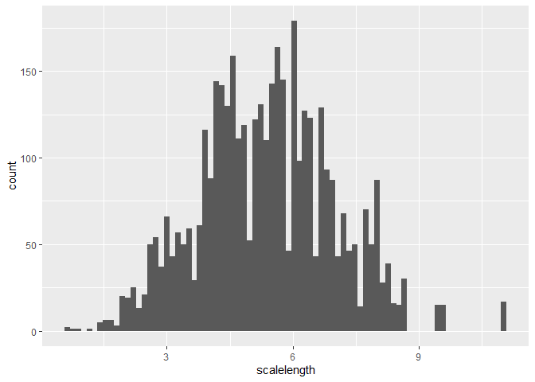

# Fish analysis
Myles Kashanipour

## Fish analysis project

Step 1 load packages and read in data

``` r
library(tidyverse)
```

    ── Attaching core tidyverse packages ──────────────────────── tidyverse 2.0.0 ──
    ✔ dplyr     1.2.1     ✔ readr     2.2.0
    ✔ forcats   1.0.1     ✔ stringr   1.6.0
    ✔ ggplot2   4.0.3     ✔ tibble    3.3.1
    ✔ lubridate 1.9.5     ✔ tidyr     1.3.2
    ✔ purrr     1.2.2     
    ── Conflicts ────────────────────────────────────────── tidyverse_conflicts() ──
    ✖ dplyr::filter() masks stats::filter()
    ✖ dplyr::lag()    masks stats::lag()
    ℹ Use the conflicted package (<http://conflicted.r-lib.org/>) to force all conflicts to become errors

``` r
fish_data <- read_csv("../DATA/Gaeta_etal_CLC_data.csv")
```

    Rows: 4033 Columns: 6
    ── Column specification ────────────────────────────────────────────────────────
    Delimiter: ","
    chr (2): lakeid, annnumber
    dbl (4): fish_id, length, radii_length_mm, scalelength

    ℹ Use `spec()` to retrieve the full column specification for this data.
    ℹ Specify the column types or set `show_col_types = FALSE` to quiet this message.

Post committing our data we are now going to compare the scale length of
fish in each length

``` r
fish_data |>
  group_by(lakeid) |>
  summarize(min_scale_length = min(scalelength, na.rm = TRUE),
            max_scale_length = max(scalelength, na.rm = TRUE),
            mean_scale_length = mean(scalelength, na.rm = TRUE))
```

    # A tibble: 16 × 4
       lakeid min_scale_length max_scale_length mean_scale_length
       <chr>             <dbl>            <dbl>             <dbl>
     1 AL                2.70              8.71              7.09
     2 AR                2.01              6.71              4.68
     3 BO                1.43              7.23              4.98
     4 BR                2.07              7.95              5.96
     5 CR                3.87              5.86              4.69
     6 DY                1.68              6.28              5.05
     7 FD                2.70              7.36              5.62
     8 JN                1.89              7.74              5.61
     9 LC                2.46              6.19              4.11
    10 LJ                2.40              4.50              3.73
    11 LR                2.47              6.52              4.92
    12 LSG               0.773             7.14              4.46
    13 MN                2.68              7.97              6.44
    14 RD                2.28              7.08              4.05
    15 UB                1.89              6.80              4.57
    16 WS                0.628            11.0               7.30

``` r
FishData<-fish_data|>filter(scalelength >1)
FishData
```

    # A tibble: 4,029 × 6
       lakeid fish_id annnumber length radii_length_mm scalelength
       <chr>    <dbl> <chr>      <dbl>           <dbl>       <dbl>
     1 AL         299 EDGE         167            2.70        2.70
     2 AL         299 2            167            2.04        2.70
     3 AL         299 1            167            1.31        2.70
     4 AL         300 EDGE         175            3.02        3.02
     5 AL         300 3            175            2.67        3.02
     6 AL         300 2            175            2.14        3.02
     7 AL         300 1            175            1.23        3.02
     8 AL         301 EDGE         194            3.34        3.34
     9 AL         301 3            194            2.97        3.34
    10 AL         301 2            194            2.29        3.34
    # ℹ 4,019 more rows

``` r
write_csv(FishData,"../DATA/FishScaleData.csv")
```

``` r
ggplot(fish_data, aes(scalelength)) +
  geom_histogram(bins=80)
```



``` r
ggsave("../DATA/scale_hist_by_length.jpg")
```

    Saving 7 x 5 in image
